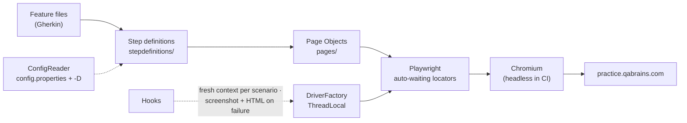

<div align="center">

# 🎭 QA Brains Automation — Java + Playwright

### Cucumber BDD suite on Playwright for Java — login, registration, password reset, e-commerce cart, navigation

[](https://git.io/typing-svg)

<!-- ============ STATUS BAR ============ -->
[](https://github.com/rbchy/QaBrainsAutomationJavaPlaywright/actions/workflows/tests.yml)
-22c55e?style=for-the-badge&logo=checkmarx&logoColor=white)


</div>

---

## 📌 At a Glance

<table>
<tr>
<td width="50%" valign="top">

**🙋 What this is**

The **Playwright for Java** edition of the QA Brains practice-site suite: user authentication (login, logout, registration, forgot password), the **e-commerce demo** (shop login, add / remove to cart, product details, product cards) and the sidebar demo modules — in plain-English Gherkin, backed by Page Objects and run by TestNG.

Playwright's **auto-waiting locators** replace hand-written waits, and every push runs the suite in **GitHub Actions** with headless Chromium.

> *Same scenarios as the Selenium edition — about three times faster.*

</td>
<td width="50%" valign="top">

**📍 Quick facts**

| | |
|---|---|
| 🧪 **Scenarios** | 15 in 7 feature files |
| ✅ **CI** | 15 / 15 · headless Chromium · 86 s |
| 🧵 **Driver** | `ThreadLocal` Playwright / Browser / Context / Page |
| 📸 **On failure** | Full-page screenshot + page HTML |
| ⚙️ **Config** | `src/test/resources/config.properties` |

</td>
</tr>
</table>

---

## ✅ Latest Results

| Feature file | Scenarios | Result |
|---|---:|---|
| 🔐 `Login.feature` | 2 |  |
| 🚪 `Logout.feature` | 1 |  |
| 📝 `Registration.feature` | 2 |  |
| 🔑 `ForgotPassword.feature` | 2 |  |
| 🛒 `CartCheckout.feature` | 2 |  |
| 🔄 `RegressionTests.feature` | 3 |  |
| 💨 `SmokeTests.feature` | 3 |  |
| **Total** | **15** | **100 % · 86 s** |

<sub>GitHub Actions, Ubuntu 24.04, Temurin 17, headless Chromium ([workflow](.github/workflows/tests.yml)). The earlier local run in [QaBrainAutomarionPlaywrightCucumber.pdf](QaBrainAutomarionPlaywrightCucumber.pdf) shows 14 / 15.</sub>

---

## 🎯 Test Coverage

<details open>
<summary><strong>🔐 Authentication</strong></summary>

<br>

| Feature | Scenarios |
|---|---|
| Login | Valid credentials · invalid credentials show *"Your email and password both are invalid!"* |
| Logout | A logged-in user logs out and the login form returns |
| Registration | Register with a valid e-mail · the browser rejects an e-mail without `@` |
| Forgot Password | Reset for a registered e-mail · a malformed e-mail is rejected (*"missing an '@'"*) |

</details>

<details>
<summary><strong>🛒 E-commerce demo</strong></summary>

<br>

All shop scenarios first log in at `/ecommerce/login` with the public practice account.

| Scenario | Check |
|---|---|
| Add product to cart | The product's button turns into *Remove from cart* |
| Remove product from cart | Nothing is left marked *Remove from cart* |
| R-01 Add multiple products | 3 added → 3 in the cart |
| R-02 Product details | Details page shows the product name and price |
| R-03 Product cards | Every card has a name, a price and an *Add to cart* button |

</details>

<details>
<summary><strong>💨 Smoke</strong></summary>

<br>

| Scenario | Check |
|---|---|
| S-01 | Home page loads |
| S-02 | Registration, Forgot Password, Form Submission and Drag and Drop List open from the sidebar |
| S-03 | The E-Commerce demo site opens from the menu |

</details>

---

## 🏗️ Framework Architecture



- **Thread-safe driver** — `DriverFactory` keeps one Playwright, Browser, BrowserContext and Page per thread
- **Auto-waiting** — locators wait for elements; the shop waits for each cart click to change the product's state
- **Robust navigation** — the menu's ids change on every load, so pages open by URL or by visible label, and new tabs are detected
- **Browser validation** — e-mail errors are read from the field's own `validationMessage`
- **Config, not code** — URL, timeout, headless and the public practice accounts live in `config.properties`; `-Dkey=value` overrides any of them

---

## 🛠️ Tech Stack

| Layer | Technology | Version |
|---|---|---|
| Language | Java | 17 |
| Browser automation | Playwright for Java (Chromium) | 1.53.0 |
| BDD | Cucumber JVM (Gherkin) | 7.15.0 |
| Runner | TestNG (`cucumber-testng`) | 7.9.0 |
| Build | Maven (Surefire 3.2.5) | — |
| Reporting | Cucumber HTML / JSON / JUnit XML | — |
| CI | GitHub Actions (Ubuntu 24.04) | — |

---

## 📁 Project Structure

```
QaBrainsAutomationJavaPlaywright/
├── .github/workflows/tests.yml        ← install Chromium, run headless on every push
├── src/test/java/
│   ├── hooks/Hooks.java               ← fresh browser per scenario, failure evidence
│   ├── pages/                         ← Login, Logout, Registration, ForgotPassword, Ecommerce
│   ├── stepdefinitions/               ← Common, Auth, Registration, ForgotPassword, Shop
│   ├── runners/TestRunner.java        ← @smoke or @regression
│   └── utils/
│       ├── DriverFactory.java         ← ThreadLocal Playwright objects, headless switch
│       ├── ConfigReader.java          ← classpath config + -D overrides
│       └── BaseTest.java              ← compatibility wrapper
├── src/test/resources/
│   ├── config.properties
│   └── features/                      ← 7 feature files, 15 scenarios
├── testng.xml
└── pom.xml
```

---

## ⚙️ Getting Started

**Prerequisites:** JDK 17+ · Maven 3.8+

```bash
git clone https://github.com/rbchy/QaBrainsAutomationJavaPlaywright.git
cd QaBrainsAutomationJavaPlaywright

# one-time: download Chromium for Playwright
mvn exec:java -e -Dexec.mainClass=com.microsoft.playwright.CLI -Dexec.args="install chromium"

mvn clean test                                   # all @smoke or @regression scenarios
mvn clean test -Dheadless=true                   # what CI runs
mvn clean test -Dcucumber.filter.tags="@Cart"    # one area
```

| Report | Location |
|---|---|
| Cucumber HTML | `target/cucumber-reports/cucumber.html` |
| JSON · JUnit XML | `target/cucumber-reports/` |
| Failure screenshots + page HTML | `target/screenshots/` and inside the HTML report |

---

## 🧹 Maintenance Log

| Change | Why |
|---|---|
| Added `pom.xml`, runner, `testng.xml`, 5 page objects and 5 step-definition classes | Only utilities, hooks and features had reached GitHub — the project could not build or run |
| Cart, smoke and regression scenarios rewritten for the site's real e-commerce demo and menu | The old ones (catalog, blog, wishlist, search, quantity) belong to another shop |
| Forgot Password expects the browser's real message (*"missing an '@'"*) | *"Please enter a valid email address"* is never shown |
| `ConfigReader` reads from the classpath | It pointed at `config/config.properties`, which does not exist |
| `DriverFactory` is the single, thread-safe driver; `DriverHelper` removed | Three classes each kept their own static browser |
| Headless switch, screenshot + HTML on failure, GitHub Actions | Every push is checked; failures explain themselves |
| CI pinned to Ubuntu 24.04 | Playwright 1.53 does not install Chromium on Ubuntu 26.04 yet |

---

## 📈 Roadmap

- [x] Complete, runnable framework with GitHub Actions
- [ ] Firefox and WebKit in a CI browser matrix
- [ ] Playwright traces attached on failure
- [ ] Parallel scenarios through the `ThreadLocal` driver
- [ ] Form Submission and Drag and Drop scenarios

---

## 🔗 Related Projects

| Project | Stack |
|---|---|
| 🧪 [QA Brains — Java + Selenium](https://github.com/rbchy/QaBrainsAutomationJavaSelenium) | Same 15 scenarios on Selenium 4 — CI green |
| 🔌 [API — Rest Assured](https://github.com/rbchy/QaBrainsAPIAutomationRestAssured) | Same site's UI plus a Rest Assured API pack — CI green |
| 🔌 [API — Postman / Newman](https://github.com/rbchy/QaBrainsAPIAutomation_Postman) | Postman · Newman — CI green |
| ⭐ [RbcTcsWorld E-Commerce Suite](https://github.com/rbchy/RbcTcsWorld_ECommerceSuite) | Spring Boot · Playwright (TypeScript) · Selenium · CI quality gates |

<sub>All projects: [github.com/rbchy](https://github.com/rbchy)</sub>

---

## 👤 Author

<div align="center">

**Ranajit Baran Chowdhury (RB Chowdhury)**
QA Automation Engineer / SDET · West Norriton, Pennsylvania, USA

[](https://www.linkedin.com/in/rbchy/)
[](https://github.com/rbchy)
[](https://rbchy.github.io/rbchy/)
[](https://rbc6543.wixsite.com/rbc-portfolio)
[](mailto:chyranajit@gmail.com)

<sub>Licensed under MIT. QA Brains is a public practice site; only its published practice accounts are used.</sub>

⭐ *If this framework helps you, a star on the repo is appreciated.*

</div>
